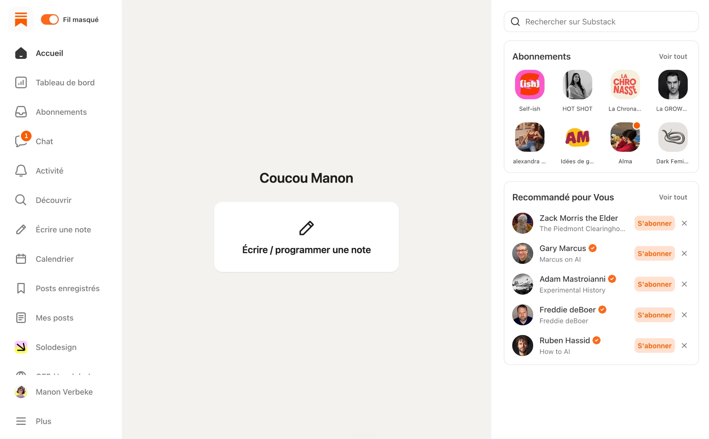
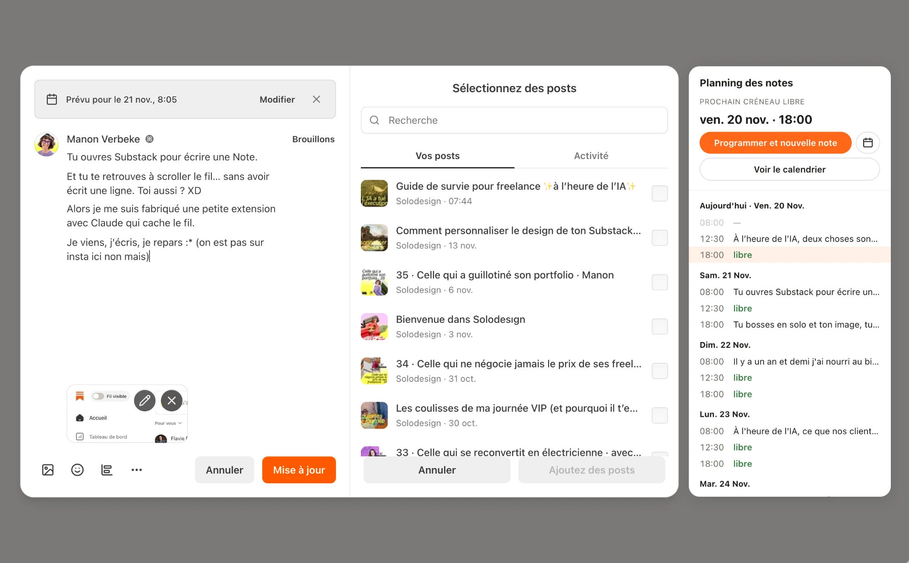
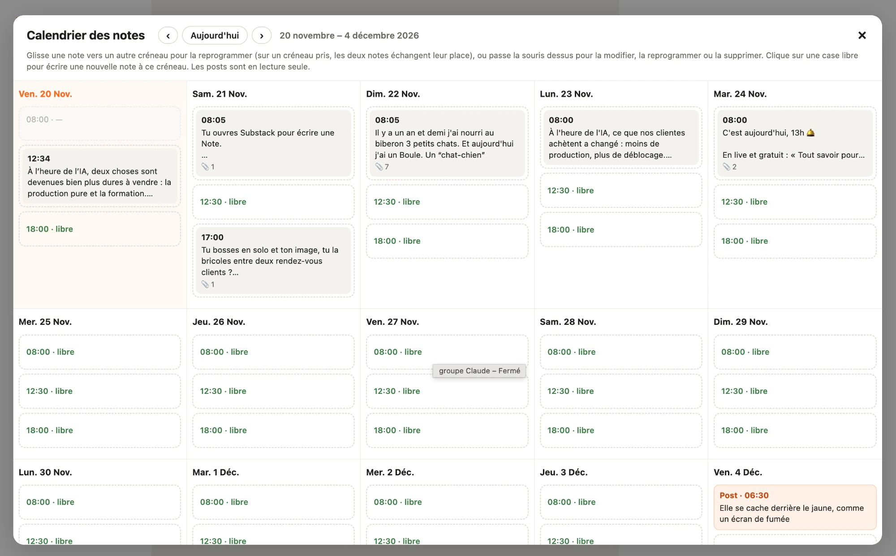

# Quiet Substack

Hide the feed, plan your Notes, stay focused on writing. A Chrome extension for Substack creators.

> Not affiliated with Substack. Available in English and French: the extension follows your Chrome language.

## What it does

- **Hides the home feed.** A switch next to the Substack logo shows or hides it. The sidebar, the right column (search, subscriptions, recommendations), your posts and your publications stay accessible.
- **Adds sidebar shortcuts:** write a Note, the Notes calendar, saved posts, your published posts and each of your publications.
- **Wider Note editor** with Post gallery and a schedule of your daily Note slots, showing the next free slot.
- **15-day Notes calendar** to move, edit, reschedule or delete your scheduled Notes.
- **Daily slots** you can add or remove from the extension popup.

Everything stays in your browser: the extension collects and sends no data.

## Install

1. Download this repository: green **Code** button → **Download ZIP**, then unzip it.
2. Open `chrome://extensions` in Chrome.
3. Turn on **Developer mode** (top right).
4. Click **Load unpacked** and select the unzipped `quiet-substack-main` folder.
5. Refresh your Substack tabs.

Pin the extension (puzzle icon → pin) to reach its settings in one click.

## Update

There are no automatic updates outside the Chrome Web Store. To get a new version:

1. Download the ZIP again and replace the old folder with the new one (same location).
2. In `chrome://extensions`, click the reload arrow on Quiet Substack.
3. Refresh your Substack tabs.

To be notified of new versions: **Watch** → **Custom** → **Releases** at the top of this page.

## If something breaks

Substack changes its pages often, and the extension relies on their layout. If a feature stops working, first refresh the tab, then check for a newer version. Still broken? Open an issue with a screenshot.

---

## En français

**Installer :** bouton vert **Code** → **Download ZIP**, dézipper, ouvrir `chrome://extensions`, activer le **mode développeur**, cliquer sur **Charger l'extension non empaquetée** et choisir le dossier `quiet-substack-main`. Rafraîchir les onglets Substack.

**Mettre à jour :** retélécharger le ZIP, remplacer l'ancien dossier, cliquer sur la flèche de rechargement de l'extension dans `chrome://extensions`, puis rafraîchir Substack.

---

## License

[GPL-3.0](LICENSE). You can use, modify and share this extension, as long as your modified versions stay open source under the same license.
